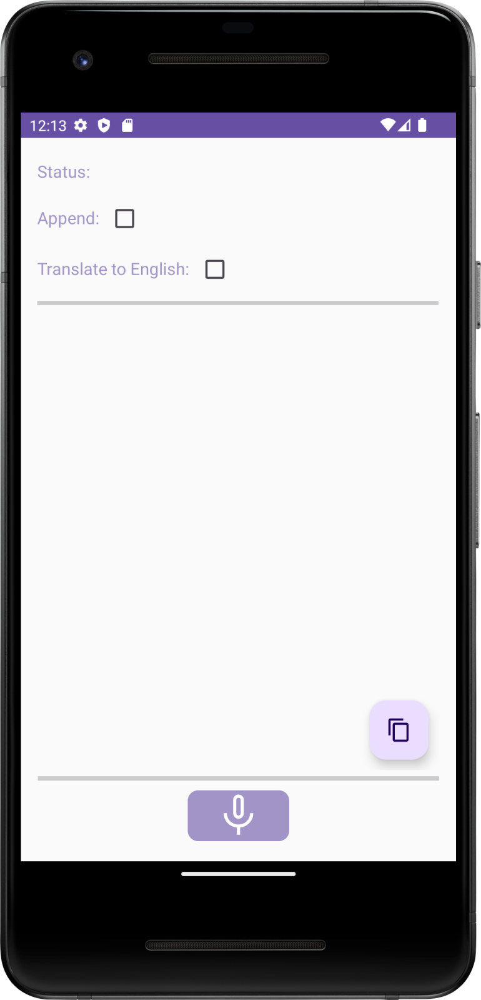
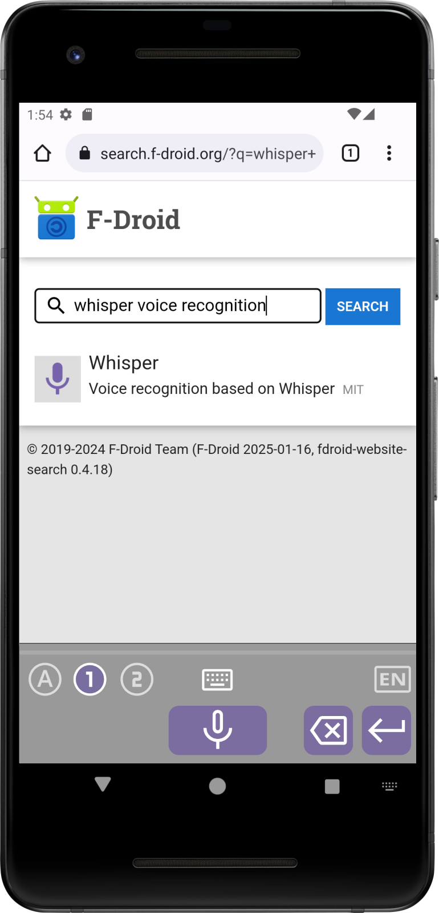
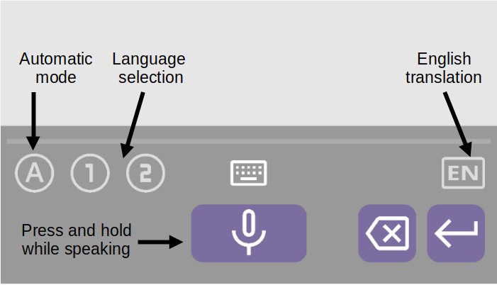

# VoxIME

Offline-Spracherkennung für Android, basierend auf der **Voxtral**-Architektur ([Voxtral-Mini-3B-2507](https://huggingface.co/mistralai/Voxtral-Mini-3B-2507), Apache-2.0) — vollständig lokal, kein Cloud-Dienst, keine Telemetrie.

VoxIME ist ein Fork von [Whisper+](https://github.com/woheller69/whisperIMEplus) (GPLv3, © woheller69), dessen Whisper-Engine durch eine Voxtral-ONNX-Engine ersetzt wurde.

  

## Funktionen

- **Eingabemethode (IME):** Diktieren in jede App, z. B. über die Mikrofon-Taste in [HeliBoard](https://github.com/hellobibo/HeliBoard)
- **Systemweiter Spracheingabe-Dienst** (RecognitionService) — in Android unter *System > Sprachen > Spracheingabe* aktivierbar
- **Standalone-App** für einzelne Diktate (max. 30 s pro Aufnahme)
- **Sprachen:** en, de, fr, es, it, pt, nl, hi (plus automatische Erkennung)
- **Komplett offline** nach einmaligem Modell-Download

## Ersteinrichtung

Beim ersten Start der App:

1. **„Download Voxtral model (~2.7 GB)"** antippen — die App lädt die ONNX-Modelldateien direkt von [Hugging Face](https://huggingface.co/onnx-community/Voxtral-Mini-3B-2507-ONNX) herunter (mit Fortschrittsanzeige; bei Abbruch wird der Download beim nächsten Versuch fortgesetzt). Alternativ kann ein Modell-Zip manuell installiert werden.
2. Danach Sprachen in den Einstellungen festlegen und loslegen.

**Hinweise:**
- Das Modell benötigt ~2,7 GB Speicher und beim Diktieren ~3 GB freien RAM. Geräte mit 6 GB RAM werden empfohlen.
- Die Erkennung eines kurzen Diktats (5–15 s Audio) dauert je nach Gerät einige Sekunden.
- Für die Nutzung als Spracheingabe-Dienst (nicht IME): App in *System > Sprachen > Spracheingabe* aktivieren. Falls die App dort nicht erscheint:
  - USB-Debugging aktivieren
  - `adb shell settings put secure voice_recognition_service org.voxime/org.voxime.VoximeRecognitionService`

## Fehlerdiagnose: Log teilen

Die App schreibt alle Engine-, Download- und Fehlermeldungen in `voxime.log` (im App-Datenordner). Im Hauptmenü (drei Punkte) gibt es **„Log kopieren"** (direkt in die Zwischenablage) und **„Log teilen"** (Datei per E-Mail/Messenger). Bei Problemen hilft sie extrem bei der Ferndiagnose.

## Tipps für gute Ergebnisse

- Sprechertaste gedrückt halten (oder automatischen Modus verwenden)
- Kurz pausieren, bevor du sprichst
- Klar und in moderatem Tempo sprechen
- Max. 30 s pro Aufnahme — für Längeres Taste loslassen und erneut drücken; weiteres Sprechen während der Erkennung ist möglich

## Architektur

Die komplette Inferenz läuft über [ONNX Runtime](https://onnxruntime.ai/) (MIT):

1. **Mel-Spektrogramm** (128 × 3000, exakte Whisper-Vorverarbeitung, Slaney-Mel-Skala)
2. **Audio-Encoder** (`audio_encoder_q4f16.onnx`) → 375 × 3072 Audio-Embeddings
3. **Prompt:** `<s>[INST][BEGIN_AUDIO][AUDIO]×375 lang:<iso> [TRANSCRIBE][/INST]` — Token-Embeddings via `embed_tokens_q4.onnx`, Audio-Positionen werden mit den Encoder-Ausgaben überschrieben
4. **Decoder-Loop** (`decoder_model_merged_q4.onnx`) mit KV-Cache, greedy bis EOS

Der Tokenizer ist byte-level BPE (Tekken); das Vokabular (`tokenizer.json`) liegt als Asset in der App, die Prompt-Token-IDs sind für alle Sprachen vorberechnet.

## Download

Aktuelle APK (0.5.5, arm64-v8a, minSdk 28) im Ordner [apks/](apks/): [apks/VoxIME-0.5.5-arm64.apk](apks/VoxIME-0.5.5-arm64.apk) (42,7 MB, Debug-Signatur). Zusätzlich baut [Actions → Android CI](https://github.com/cirstoph/VoxIME/actions) bei jedem Push eine frische Debug-APK als Artefakt („VoxIME-debug“).

**Wichtig:** Neue Signatur — falls eine ältere Version installiert ist, vorher deinstallieren. Vor dem ersten Diktieren lädt die App das Voxtral-Modell (~2,7 GB) herunter; die App prüft alle sieben Dateien auf Vollständigkeit, bevor die Engine startet. **Hinweis zur Funktion:** Übersetzung („Translate“) wird von der Voxtral-Engine aktuell nicht unterstützt und ist daher deaktiviert — die App transkribiert ausschließlich.

## Changelog

### 0.5.5 (2026-10-15)
- **Messdaten-basierter Fix:** Erste StageTiming-Messung zeigte 78 % der Wartezeit im Encoder (26,1 s von 33,7 s bei 4 s Audio), weil er bei kurzen Aufnahmen das volle 30-s-Fenster verrechnet. Instrumentierungsfehler behoben (negatives pcm_convert durch gemischte Zeitquellen).
- **Variable Encoder-Länge (Experiment, standardmäßig aus):** `tools/patch_encoder_varlen.py` erzeugt aus dem vorhandenen Modell einen Encoder mit dynamischer Zeitachse (Gewichte/Dateien unverändert). In den Einstellungen aktivierbar („Fast encoder (experimental)“), sobald die gepatchte Datei `audio_encoder_var_q4f16.onnx` neben dem Modell liegt; wirkt sofort ohne Neustart (Engine wird beim Umschalten neu geladen). Referenzmessung: 5,5 s → 0,7 s Encoder-Zeit für 4 s Audio. Hinweis: die Encoder-Attention ist nicht kausal — die Features unterscheiden sich leicht vom Vollfenster; A/B-Transkriptionsvergleich auf dem Gerät empfohlen (Details: `docs/performance-0.5.4.md`).
- Unit-Tests: Mel-Präfix-Eigenschaft der variablen Frame-Zahl gesichert; CI führt `testDebugUnitTest` aus.
- Settings-UI: Schalter „Fast encoder“ als eigene Zeile (zuvor innerhalb der Bluetooth-Zeile verschachtelt und faktisch unsichtbar).

### 0.5.4 (2026-10-14)
- **Performance:** Mel-Frontend mit echter 400-Punkt-FFT statt direkter DFT (vorher ~241 Mio. innere Schleifendurchläufe pro Diktat, unabhängig von der Audiolänge); Hann-Fenster/Mel-Filterbank statisch vorberechnet; Frames vollständig hinter dem realen Audio werden analytisch als Nullleistung behandelt. Gegenüber der alten Implementierung numerisch identisch (Unit-Test gegen die DFT-Referenz).
- **Performance:** Decoder-Logits werden nur noch für die letzte Position über den flachen Tensor-Buffer gelesen statt [1,S,131072] vollständig als Java-Array zu materialisieren (vorher bis ~190 MiB Heap beim Prefill).
- **Speicher/Lifecycle:** Prozessweite Engine-Registry — App, IME und RecognitionService hielten zuvor je eine eigene Kopie aller drei ONNX-Sessions im selben Prozess; jetzt ein residenter Satz. Der RecognitionService erzeugt keine neue Engine + Recorder mehr pro Anfrage.
- **Abbruch:** `Voxime.stop()` bricht laufende Transkriptionen jetzt zwischen Phasen und Decoder-Schritten ab; abgebrochene Aufträge liefern kein Resultat mehr. `Recorder.stop()` blockiert den Main Thread nicht mehr.
- **Aufnahme:** VAD erhält jeden Frame direkt aus dem Aufnahmepuffer statt den gesamten Puffer pro Schritt zu kopieren (~480 MB Kopiervolumen bei 30 s entfallen).
- **Messung:** strukturierte Phasen-Timings (StageTiming) — eine JSON-Zeile pro Diktat in voxime.log/logcat mit allen Pipeline-Phasen, Decoder-Statistiken und Abbruchgrund.
- **Logging:** Datei-Log schreibt in einem Hintergrund-Thread; kein synchroner FileWriter mehr auf Inferenz-/UI-Threads.
- Details: `docs/performance-0.5.4.md`.

### 0.5.3 (2026-10-09)
- **Bugfix:** `VoxtralEngine.loadModel()` erzeugte die drei ONNX-Sessions nicht mehr (in 0.5.2 beim Einfügen der Lade-Fortschrittsanzeige versehentlich entfernt) — jede Transkription crashte mit `IllegalStateException: Engine not loaded`. Die Aufrufe sind wiederhergestellt, jetzt mit Fortschrittsmeldung pro Schritt (Encoder 384 MB → Embeddings 252 MB → Decoder 2,3 GB).
- **CI:** GitHub Actions baut bei jedem Push/PR automatisch den Debug-APK ([Actions → Android CI](https://github.com/cirstoph/VoxIME/actions)) und lädt ihn als Artefakt hoch; außerdem ergänzt: das fehlende `gradlew`-Startskript, ohne das frische Clones nicht bauen konnten.
- **Aufräumen:** tote Felder aus der Whisper-Ära entfernt (`textPromptCache`, `langTokens`, `promptIds`), Worker-Thread in `voxime-worker` umbenannt, `RecordBuffer.getSamples()` wirft keine NPE mehr bei leerem Puffer, falscher RecognitionService-Paketname in der README korrigiert.
- Die kaputte Release-APK `apks/VoxIME-0.5.2.apk` wurde aus dem Repo entfernt.

### 0.5.2 (2026-10-09)
- Lade-Fortschrittsanzeige im UI — **enthielt aber den Session-Bug, siehe 0.5.3.**

### 0.5.1 (2026-10-09)
- XNNPACK-Experiment und Encoder-Thread-Cap reverted (beides auf dem Gerät langsamer, siehe Commit 2495720).

### 0.5.0 (2026-10-09)
- Halluzinations-Schleifen behoben: 0,64 s Stille nach der Sprache im Prompt („Silence Margin“), Wiederholungs-Guard im Decoder (Abbruch nach 6 identischen Tokens), dynamischer Prefill (Audio-Token-Anzahl passt zur echten Audiobänge, ~9× schnellerer Prefill bei kurzen Diktaten).

### 0.2.1 / früher
- ONNX Runtime 1.19 → 1.22 (behebt `GatherBlockQuantized is not a registered op` beim Laden von `embed_tokens_q4.onnx`), Whisper-Reste entfernt, Umbenennung auf `org.voxime`, Datei-Logging (`voxime.log`), In-App-Modell-Download.

## Lizenz & Credits

GPLv3 — siehe [LICENSE](LICENSE) und [NOTICE.md](NOTICE.md).

- Basiert auf [Whisper+ / whisperIMEplus](https://github.com/woheller69/whisperIMEplus) (GPLv3, © woheller69), das auf [whisperIME](https://github.com/woheller69/whisperIME) (MIT), [RTranslator](https://github.com/niedev/RTranslator) (Apache-2.0) und [whisper_android](https://github.com/vilassn/whisper_android) (MIT) aufbaut
- Sprachmodell: [Voxtral-Mini-3B-2507](https://huggingface.co/mistralai/Voxtral-Mini-3B-2507) und der [ONNX-Export](https://huggingface.co/onnx-community/Voxtral-Mini-3B-2507-ONNX) von Mistral AI / onnx-community (Apache-2.0)
- Laufzeit: [ONNX Runtime](https://github.com/microsoft/onnxruntime) (MIT)
- [Android VAD](https://github.com/gkonovalov/android-vad) (MIT), [Opencc4j](https://github.com/houbb/opencc4j) (Apache-2.0)
